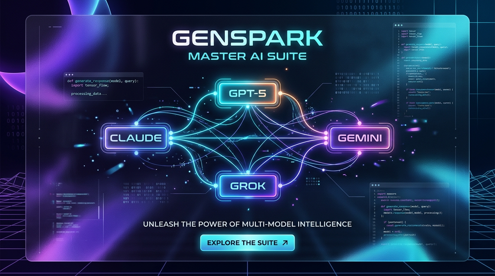
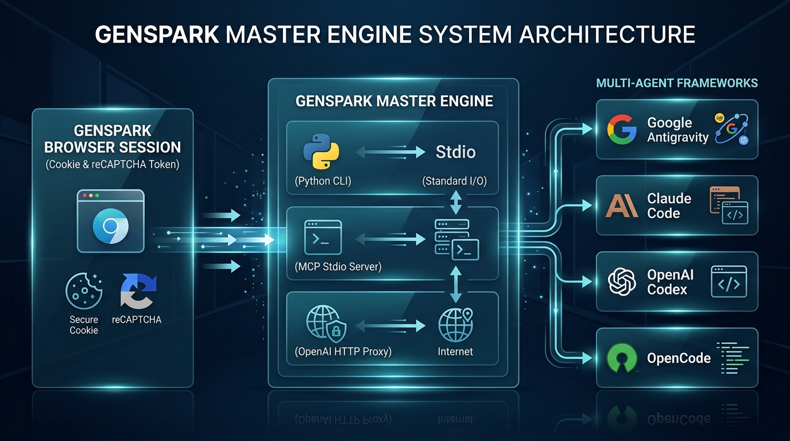
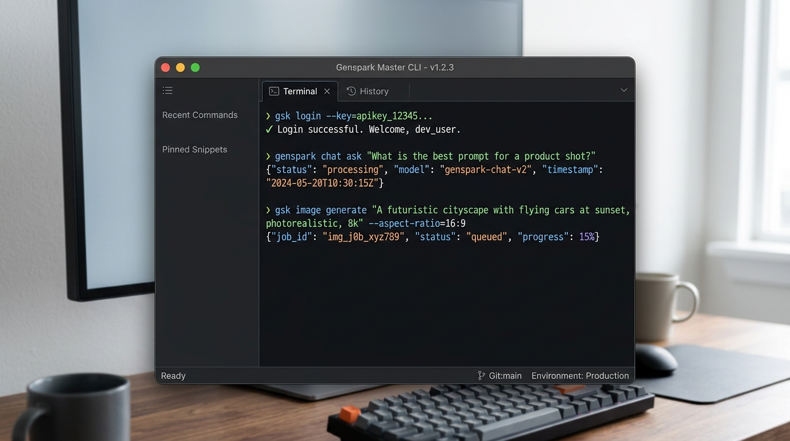

# ✨ Genspark Master AI Suite

**The Ultimate Browser-Session AI Engine for Multi-Account Chat, Parallel Batch, Image Generation, MCP, and Multi-Agent Skills**

[](https://github.com/tody-agent/genspark-master/actions)
[](https://python.org)
[](LICENSE)
[](#-mcp-server-registration-multi-agent-support)
[](#-supported-ai-models)
[](#-supported-ai-models)
[](#-universal-3-agent-plugin-support)

---

## 🚀 System Architecture



**Genspark Master** turns your browser sessions into a high-performance, developer-first AI powerhouse. It provides an interactive human-first CLI with guided onboarding (`gsk`), a cross-process **Multi-Account Pool** with automatic `round-robin` + `least-busy` load balancing and instant quota failover, a **Parallel Multi-Account Batch Engine** (`gsk batch`), **9 production-grade MCP tools**, a local OpenAI-compatible HTTP proxy server, and native `.plugin` bundles for **Google Antigravity**, **Claude Code**, and **OpenAI Codex**.

📖 **Quick Links**:
- [Technical Architecture Guide](docs/ARCHITECTURE.md)
- [Installation & Setup Guide](docs/INSTALLATION.md)
- [Changelog & Release Notes](CHANGELOG.md)

---

## 💻 Developer Terminal Experience



---

## 🔥 Key Features

- 🔑 **Zero API Key Requirement**: Authenticates via browser session state (`storage_state.json` & reCAPTCHA token).
- 🧭 **Human-First Interactive Menu & Onboarding**: Simply run `gsk` in your terminal. First-time users get a guided 3-step setup; afterwards, a clean numbered menu lets you chat, manage accounts, generate images, or tune settings without memorizing commands.
- 🔄 **Multi-Account Pool & Auto-Routing**: Manage unlimited Genspark accounts (`gsk accounts` / `gsk pool`), distribute load via `round-robin` (with `least-busy` active-request balancing), `least-used`, or `failover`, and automatically switch accounts when one hits rate limits (`429`) or quota exhaustion (`402`).
- ⚡ **Parallel Multi-Account Batch Engine**: Run tens or hundreds of chat prompts or image generations concurrently across all healthy accounts (`gsk batch` / MCP `batch_chat` & `batch_generate_images`) without waiting.
- 🧠 **40 Flagship Chat AI Models**: Claude Opus 5.5, Claude Opus 4.7, GPT-6 Sol, GPT-5.4, Gemini 3.8 Flash, DeepSeek V4.1 Flash, GLM-5.3 Flash, Xiaomi MiMo, Moonshot Kimi, and more.
- 🎨 **9 Next-Gen Image Models**: Flux 2 Pro, GPT Image 2, Nano Banana 2, Seedream v5 Lite, Z-Image Turbo, up to 4K resolution & 170+ styles.
- 🤖 **Universal Multi-Agent Skills**: 4 pre-packaged skills (`genspark`, `gen-chat`, `gen-imagegen`, `gen-setup`) ready for all AI coding assistants.
- 🔌 **Built-in MCP Server (9 Tools)**: Exposes `chat`, `chat_with_context`, `batch_chat`, `generate_image`, `batch_generate_images`, `configure_pool`, `get_models`, `list_image_models`, and `check_status`.
- 🌐 **Local OpenAI HTTP Proxy**: Run `genspark server start` to expose `http://127.0.0.1:8080/v1/chat/completions` and `/v1/images/generations` backed by the multi-account pool.

---

## 🎨 Image Generation Gallery


*Generate 170+ artistic styles across 14 aspect ratios (`16:9`, `9:16`, `1:1`, `3:4`...) and resolution output up to 4K.*

---

## 🎯 Real-World Use Cases

### 💡 Use Case 1: Multi-Model Second Opinions & Code Reviews
Query different SOTA reasoning engines instantly for architecture reviews or code security audits:
```bash
gsk chat ask "Analyze this deadlock condition in Python asyncio" --model claude-opus-5.5
gsk chat ask "Provide a second opinion on memory safety" --model gpt-6-sol
```

### 🎨 Use Case 2: Free High-Res AI Art & Assets for Web Apps
Generate hero images, UI mockups, icons, and marketing assets directly from your terminal or AI Agent:
```bash
genspark image generate "editorial fashion portrait of a model in cyberpunk city" \
  --model flux-2-pro \
  --style "Oil Painting" \
  --ratio 3:4 \
  --size 2K \
  --output ./assets
```

### 🌐 Use Case 3: Local OpenAI API Bridge for Coding Assistants
Power Cursor, Continue, or custom scripts using your local Genspark proxy without paying per-token API fees:
```bash
# Start the local server
genspark server start --port 8080

# Call via standard OpenAI API client
curl http://127.0.0.1:8080/v1/chat/completions \
  -H 'Content-Type: application/json' \
  -d '{"model": "gpt-6-sol", "messages": [{"role": "user", "content": "Refactor this function"}]}'
```

### 🤖 Use Case 4: Autonomous Agent Execution (Antigravity, Codex, Claude Code)
When working with AI Agents, invoke `genspark`, `gen-chat` or `gen-imagegen` skills directly inside your conversation context:
```text
User: "/gen-imagegen create an isometric 3D icon for my banking app using Flux 2 Pro"
Agent: Executing Genspark CLI -> Tải ảnh 2K về thư mục dự án!
```

### ⚡ Use Case 5: Fast AI Runner & Autonomous Code Execution (`genspark run`)
Execute questions, piped inputs, code reviews, and run AI-generated scripts in real-time:
```bash
# Direct execution with live streaming (or shorthand: gsk "prompt")
gsk "Explain how WebSockets work under the hood"

# Pipe stdin from files or Git
git diff | genspark run "Review these changes for security vulnerabilities"

# Autonomous Code Runner (extracts and runs generated Python/Bash scripts locally)
genspark run -x "Write a Python script to benchmark memory throughput"
```

### 🔄 Use Case 6: Multi-Account Pool & Parallel Batch Execution (`gsk pool` & `gsk batch`)
Scale large projects across multiple Genspark accounts concurrently with zero waiting:
```bash
# Manage accounts interactively or via CLI
gsk accounts
gsk pool status
gsk pool strategy round-robin
gsk pool ping

# Interactive configuration wizard
gsk config -i

# Run parallel chat batch across all healthy accounts
gsk batch "Audit auth.py" "Audit router.py" "Audit server.py" -c 6 --json

# Run parallel image batch across all healthy accounts
gsk batch --image "Hero banner A" "Hero banner B" "Hero banner C" -m flux-2-pro -o ./assets
```

---

## 🤖 Supported AI Models

### 💬 Chat Models (40 SOTA Models Available)

| Model ID | Provider | Tier | Multiplier | Reasoning | Key Strengths |
| :--- | :--- | :--- | :--- | :--- | :--- |
| `claude-opus-5.5` ★ | **Anthropic** | Ultra | 4.0× | **Yes** | **Default Model**. Flagship reasoning & architectural synthesis. |
| `claude-opus-4-7` | **Anthropic** | Ultra | 5.0× | **Yes** | High-capacity reasoning & code analysis. |
| `claude-sonnet-5.5` | **Anthropic** | Premium | 2.0× | No | Balanced everyday engineering & UI design. |
| `gpt-6-sol` 🔥 | **OpenAI** | Premium | 2.0× | No | Next-generation OpenAI flagship model. |
| `gpt-6.1-sol` | **OpenAI** | Premium | 2.0× | No | Advanced GPT-6.1 logic engine. |
| `gpt-5.4` | **OpenAI** | Premium | 3.0× | No | Standard GPT-5.4 flagship model. |
| `gemini-3.8-flash` | **Google** | Fast | 0.75× | No | Ultra-fast multimodal reasoning engine. |
| `gemini-3.1-pro-preview` | **Google** | Premium | 2.0× | No | Long-context deep reasoning. |
| `deepseek-v4.1-flash` 🔥 | **DeepSeek** | Fast | 0.3× | No | Ultra-low cost, high-speed coding. |
| `glm-5.3-flash` 🔥 | **ZhipuAI** | Fast | 0.15× | No | Extreme throughput fast inference. |
| `mimo-v2.6-pro` | **Xiaomi** | Fast | 0.435× | No | Xiaomi Pro reasoning model. |
| `kimi-k3` | **Moonshot** | Premium | 3.0× | No | Long-context research. |
| `grok-4.7` | **xAI** | Premium | 2.0× | No | Real-time perspective & fast review. |

*Run `gsk models list` or `gsk models list --json` to inspect all 40 supported models.*

---

### 🎨 Image Generation Models (9 Next-Gen Engines)

| Model ID | Provider | Max Res | Best For / Key Features |
| :--- | :--- | :--- | :--- |
| `nano-banana-2` ★ | **Google** | **4K** | **Default**. Gemini 3.1 Flash Image. Fast generation with advanced reasoning. |
| `flux-2-pro` | **Black Forest Labs** | **4K** | Premium quality, photorealism, fine details, cinematic lighting. |
| `gpt-image-2` | **OpenAI** | **4K** | Superior text rendering, precise elements, face preservation. |
| `nano-banana-pro` | **Genspark** | **4K** | SOTA generation & editing. Multi-image composition (up to 14 input images). |
| `seedream-v5-lite` | **ByteDance** | **3K** | Multi-image editing, Chinese typography, fashion & portraiture. |
| `z-image-turbo` | **Genspark** | **2K** | Ultra-fast generation. |
| `flux-2` | **Black Forest Labs** | **2K** | Enhanced realism with crisp text and fast composition editing. |

---

## ⚡ Installation & Setup

For full details, read the [Installation Guide](docs/INSTALLATION.md).

### 1. Clone & Install Environment
Python 3.10+ is required:
```bash
git clone https://github.com/tody-agent/genspark-master.git
cd genspark-master
./scripts/install.sh
```

### 2. Global Executables Symlink
Symlink CLI executables into `~/.local/bin/` so you can run `genspark` or `gsk` from any shell folder:
```bash
ln -sf $(pwd)/bin/genspark ~/.local/bin/genspark
ln -sf $(pwd)/bin/gsk ~/.local/bin/gsk
ln -sf $(pwd)/bin/genspark-mcp ~/.local/bin/genspark-mcp
```

### 3. Deploy Multi-Agent Skills Globally
To make `genspark`, `gen-chat`, `gen-imagegen`, and `gen-setup` available to all AI agents on your machine:
```bash
mkdir -p ~/.gemini/config/skills \
         ~/.claude/skills \
         ~/.codex/skills

for skill in genspark gen-chat gen-imagegen gen-setup; do
  cp -r ./skills/$skill ~/.gemini/config/skills/
  cp -r ./skills/$skill ~/.claude/skills/
  cp -r ./skills/$skill ~/.codex/skills/
done
```

---

## 🔌 Universal 3-Agent Plugin Support

Genspark Master adheres to standard plugin specifications across the top 3 AI coding environments:

### 1. Google Antigravity (`agy`)
Configured via `plugin.json` and `mcp_config.json`:
```bash
# Validate plugin
agy plugin validate .

# List loaded components
agy plugin list
```

### 2. Anthropic Claude Code
Configured via `.claude-plugin/plugin.json`:
```bash
# Validate plugin
claude plugin validate .

# Register MCP server
claude mcp add genspark -- /absolute/path/to/genspark-master/bin/genspark-mcp
```

### 3. OpenAI Codex
Configured via `.codex-plugin/plugin.json` and `.mcp.json`. Build standalone package:
```bash
./scripts/package.sh
```

---

## 🔌 MCP Server Registration (Multi-Agent Support)

Register `genspark-mcp` across your AI Agent configuration files.

### Standard `mcp.json` (Claude Code, OpenAI Codex, Google Antigravity)
Add to `~/.claude/mcp.json`, `~/.codex/mcp.json`, or `~/.gemini/config/mcp_config.json`:
```json
{
  "mcpServers": {
    "genspark": {
      "command": "/absolute/path/to/genspark-master/bin/genspark-mcp"
    }
  }
}
```

### Available MCP Tools (9 Tools)
| Tool Name | Scope | Description |
| :--- | :--- | :--- |
| `genspark:chat` | Chat | Send a message to any AI model with automatic multi-account failover. |
| `genspark:chat_with_context` | Chat | Multi-turn chat with custom system prompts. |
| `genspark:batch_chat` | Parallel Batch | Run multiple prompts concurrently across all healthy accounts. |
| `genspark:generate_image` | Image | Generate high-res images with 9 free models, styles, and aspect ratios. |
| `genspark:batch_generate_images` | Parallel Batch | Generate multiple images in parallel across all accounts. |
| `genspark:configure_pool` | Management | Inspect or update routing strategy (`round-robin`, `least-used`, `failover`). |
| `genspark:get_models` | Discovery | List all 40 available AI models and credit multipliers. |
| `genspark:list_image_models` | Discovery | List available image generation models and resolutions. |
| `genspark:check_status` | Diagnostics | Check session health and active profile state. |

---

## 🔐 Authentication & Onboarding

**Easiest way:** Just run `gsk` in your terminal.
- First run launches a **guided 3-step onboarding** to log in your first account and set up routing.
- Subsequent runs display an interactive numbered menu:
  ```text
  1 · 💬 Trò chuyện với AI
  2 · 👥 Tài khoản (thêm · đăng nhập · đăng xuất · xoá)
  3 · 🎨 Tạo ảnh
  4 · ⚙️  Cài đặt (model mặc định, chế độ xoay vòng, số luồng)
  5 · 📡 Kiểm tra tài khoản còn hoạt động không
  6 · ❓ Hướng dẫn nhanh
  0 · Thoát
  ```
- Manage accounts anytime with `gsk accounts` or slash commands `/accounts`, `/login`, `/logout`, `/menu` inside chat.

---

## 🛠️ Diagnostics & Quality Gate

Run offline health checks:
```bash
gsk doctor --json
gsk capabilities --json
gsk pool ping
```

Run full test suite (123 unit tests + bytecode compilation + plugin check):
```bash
./scripts/test_gate.sh
```

---

## 📜 Disclaimer & License

*This is an unofficial browser-session client and skill suite. All model trademarks belong to their respective creators (OpenAI, Anthropic, Google, Black Forest Labs, ByteDance, xAI, Genspark).*

Released under the [MIT License](LICENSE).
